# Sistema Administrativo FILEY
### Gestión de stands y reservaciones mediante Java, JDBC y MVC

Este proyecto consiste en una aplicación de escritorio desarrollada en Java para administrar los stands, las editoriales y las reservaciones de la Feria Internacional de la Lectura Yucatán (FILEY).

El sistema permite llevar un control de los espacios disponibles, registrar editoriales, gestionar reservaciones y dar seguimiento a los pagos realizados. Para almacenar la información se utiliza una base de datos MySQL, conectada mediante JDBC.

El desarrollo está organizado bajo el patrón MVC (Modelo-Vista-Controlador), separando la interfaz gráfica, la lógica del sistema y el acceso a la base de datos. También se implementan otros patrones de diseño, como DAO, Singleton y Observer, para organizar mejor las responsabilidades del programa.

---

## Video de presentación

- **Enlace al video PD4:** https://drive.google.com/file/d/166lBz3rK0SpOkuP6g2O_5-dQiaBAxV4c/view?usp=sharing

---

## Diagrama Entidad-Relación (Base de Datos `filey_db`)




## DIAGRAMA DE CLASES 

El siguiente diagrama muestra la estructura del sistema, sus principales clases y las relaciones entre ellas. Se incluyen las entidades, la capa de persistencia, la lógica de negocio, el sistema de notificaciones y los componentes de MVC.




---

## Funcionalidades principales

- **Conexión con MySQL:** El sistema utiliza JDBC para comunicarse con la base de datos. La conexión se administra desde `ConexionDB`, mientras que las consultas se realizan mediante la capa DAO utilizando `PreparedStatement`.

- **Administración de stands:** Permite gestionar los espacios disponibles para la feria, considerando sus dimensiones, el costo por metro cuadrado y su estado actual. Los estados contemplados son `DISPONIBLE`, `RESERVADO`, `OCUPADO` y `BLOQUEADO`.

- **Registro de editoriales:** Mantiene un catálogo de las editoriales participantes, almacenando su identificador, nombre y correo electrónico de contacto.

- **Gestión de reservaciones:** Permite relacionar una editorial con un stand, registrar los pagos parciales y establecer las fechas límite para realizar la reserva, aprovechar el pronto pago y completar la liquidación.

- **Control de pagos y estados:** El costo de cada stand se calcula tomando en cuenta sus dimensiones y el precio por metro cuadrado. Además, cuando los pagos acumulados alcanzan al menos el 15 % del costo total, el estado del stand cambia automáticamente de `RESERVADO` a `OCUPADO`.

- **Operaciones seguras:** Al registrar una reservación se utiliza una transacción para guardar la información y actualizar el estado del stand como una sola operación. Si ocurre algún error, los cambios se revierten mediante `rollback()` para evitar inconsistencias en la base de datos.

- **Sistema de notificaciones:** El programa revisa las fechas importantes de las reservaciones activas para identificar vencimientos relacionados con la reserva, el pronto pago y la liquidación total. Para ello se utiliza el patrón Observer.

- **Interfaz gráfica:** La aplicación cuenta con una interfaz desarrollada en Java Swing, donde se muestran los registros mediante tablas y controles para interactuar con el sistema. La comunicación entre la interfaz y el resto de los componentes se realiza mediante `FileyController`.

## Estructura del proyecto

```text
filey-pd4/
├── database/
│   └── schema.sql                  # Estructura y datos iniciales de la BD
├── docs/
│   └── diagrama-clases.png         # Diagrama de clases UML
├── lib/
│   └── mysql-connector-j-26.10.0.jar
├── src/com/filey/
│   ├── controlador/
│   │   └── FileyController.java    # Controlador de la aplicación
│   ├── datos/
│   │   ├── Editorial.java          # Datos de las editoriales
│   │   ├── EstadoStand.java        # Estados posibles de un stand
│   │   ├── Reservacion.java        # Datos de las reservaciones
│   │   └── Stand.java              # Datos de los stands
│   ├── logica/
│   │   ├── GestorOperacionesImpl.java
│   │   └── IGestorOperaciones.java
│   ├── main/
│   │   └── Main.java               # Inicio de la aplicación
│   ├── notificaciones/
│   │   ├── IObservadorAlerta.java
│   │   ├── MotorNotificaciones.java
│   │   └── ObservadorConsola.java
│   ├── persistencia/
│   │   ├── ConexionDB.java         # Administración de la conexión
│   │   ├── EditorialDAOImpl.java
│   │   ├── IEditorialDAO.java
│   │   ├── IReservacionDAO.java
│   │   ├── IStandDAO.java
│   │   ├── ReservacionDAOImpl.java # Registro y control de transacciones
│   │   └── StandDAOImpl.java
│   └── vista/
│       └── FileyView.java          # Interfaz gráfica en Swing
├── run.bat                         # Compilación y ejecución
└── README.md
```

## Tecnologías y patrones utilizados

- **Lenguaje:** Java.
- **Interfaz gráfica:** Java Swing.
- **Base de datos:** MySQL.
- **Conexión:** JDBC.
- **Arquitectura:** Modelo-Vista-Controlador (MVC).
- **Patrones de diseño:** DAO, Singleton y Observer.

