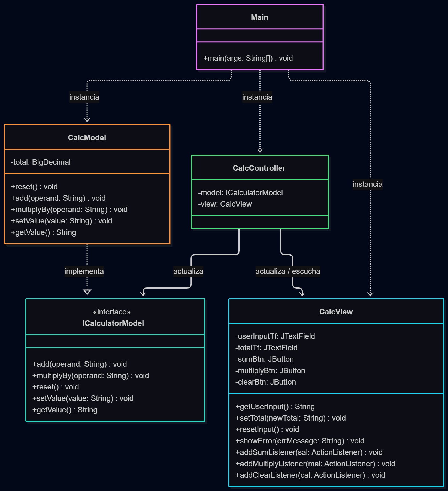

# Calculadora en Java - Arquitectura MVC

 **[Video de PD3](https://drive.google.com/file/d/1YaEFJqlihz_jwwRK_6Tt2aGLWZhVS-QH/view?usp=sharing)**

## Descripción del Proyecto
Implementación de una calculadora  desarrollada en Java bajo el patrón de diseño arquitectónico MVC (Modelo-Vista-Controlador). El proyecto está diseñado con un enfoque estricto en la separación de responsabilidades (*Separation of Concerns*) y bajo acoplamiento.
---

## Arquitectura e Implementación
El sistema se divide en tres capas principales para aislar la interfaz de usuario de la lógica de negocio:

### 1. Capa de Modelo (`CalcModel.java`, `ICalculatorModel.java`)
Encargada del estado de la aplicación y la lógica matemática pura.
* **Precisión:** Utiliza `java.math.BigDecimal` para mitigar las imprecisiones de coma flotante a los tipos primitivos (`double`, `float`).
* **Abstracción:** Implementa la interfaz `ICalculatorModel`, lo que permite inyectar dependencias de forma limpia y facilita la creación de mocks para futuras pruebas unitarias.

### 2. Capa de Vista (`CalcView.java`)
Gestiona la interfaz gráfica de usuario mediante la biblioteca `javax.swing`.
 Carece de lógica de control o de negocio. Su única responsabilidad es inicializar y renderizar los componentes, y exponer métodos públicos para que la capa superior registre los manejadores de eventos (*Listeners*) y actualice el estado visual.

### 3. Capa de Controlador (`CalcController.java`)
Ejerce como controlador del sistema.
Implementa clases internas (`ActionListener`) para capturar la interacción del usuario de forma independiente y Recupera los parámetros de entrada de la Vista, invoca los métodos de cálculo correspondientes en la interfaz del Modelo, y finalmente ordena a la Vista el refresco de los componentes con los nuevos resultados.


## Análisis de Escalabilidad: Integración de Nuevas Operaciones

Para garantizar que el sistema cumpla con el de SOLID al momento de escalar las operaciones soportadas ej. añadir resta, división, potencias, se documenta la siguiente evaluación arquitectónica:

* **Evaluación del Patrón Command:**
  * *Ventajas:* Desacopla de manera absoluta el objeto que invoca la operación del objeto que sabe cómo ejecutarla. Es la solución óptima si el sistema requiriera mantener un historil de operaciones en memoria.
  * *Desventajas:* Introduce una complejidad excesiva para un modelo de cálculo en tiempo real que no requiere trazabilidad de estados. Exigiría implementar clases invocadoras, receptores y una interfaz Command base, fragmentando el flujo de ejecución directo.
* **Estrategia Seleccionada:**
  * Ante la sobreexigencia del Command, la estrategia óptima es aislar las operaciones mediante inyección de dependencias. Definiendo una interfaz base ej. `Operacion`, el Controlador puede despachar la lógica matemátca de forma dinámica. Esto preserva la limpieza de la arquitectura MVC y permite escalar el software sin alterar el código existente de la Vista ni del Modelo principal.


## Diagrama de Clases
El siguiente modelo de UML define las dependencias, asociaciones e implementaciones entre los componentes del sistema.


---

## Despliegue y Ejecución

### Requisitos Previos
* Java Development Kit (JDK) 8 o superior.
* Entorno de consola (Terminal, CMD o Bash).

### Instrucciones de Compilación
1. Clonar el repositorio y acceder al directorio de código fuente:
   ```bash
   > git clone https://github.com/DevFunCoding/sistema-stands-filey.git
   > cd [Sistema_Calculadora]
   > javac -d Ejecutar Sistema_Calculadora/*.java
   > java -cp Ejecutar Main    
