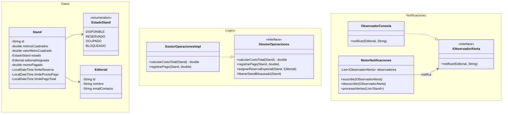

# Sistema Administrativo de Stands - FILEY

## 1. Requisitos Funcionales Implementados

1. **Gestión de Estados de Stands:**
   - `DISPONIBLE`: Abierto a reservación general.
   - `BLOQUEADO`: Reservación especial por el administrador. Permite la transición manual a `DISPONIBLE` o la asignación directa a `RESERVADO`.
   - `RESERVADO`: Asignado a una entidad editorial. Incluye validación de tiempos límite de reserva y aplicación de pronto pago.
   - `OCUPADO`: Transición de estado automatizada al registrarse un pago que cubra, como mínimo, el 15% del costo total del stand.
2. **Cálculo de Costos:** Se determina mediante la fórmula: Dimensiones ($m^2$) $\times$ Valor por $m^2$.
3. **Motor de Notificaciones:** Sistema de evaluación  de fechas límite para la emisión de alertas relacionadas con el vencimiento de reservas, caducidad de pronto pago y fecha máxima de liquidación total.

---

## 2. Arquitectura del Sistema (Diseño por Paquetes)

- `com.filey.datos`: Modelos del dominio (`Stand`, `Editorial`, `EstadoStand`).
- `com.filey.logica`: Definición de contratos e implementación de las reglas de negocio (`IGestorOperaciones`, `GestorOperacionesImpl`).
- `com.filey.notificaciones`: Componentes del patrón Observer para el manejo de eventos y alertas (`IObservadorAlerta`, `ObservadorConsola`, `MotorNotificaciones`).
- `com.filey.main`: Interfaz de usuario interactiva basada en línea de comandos (CLI).

---

## 3. Diagrama de Clases UML



---

## 4. Instrucciones de Compilación y Ejecución

Para garantizar la compatibilidad con entornos de ejecución Java 8 o versiones posteriores, es imperativo utilizar el parámetro de compilación correspondiente.

```bash
# 1. Compilación del código fuente especificando la compatibilidad con Java 8
javac --release 8 src/com/filey/datos/*.java src/com/filey/logica/*.java src/com/filey/notificaciones/*.java src/com/filey/main/Main.java -d out/

# 2. Ejecución del sistema interactivo
java -cp out com.filey.main.Main
```


# Requisitos - Sistema FILEY

| ID | Categoría | Requisito | Descripción y Regla de Negocio |
| :--- | :--- | :--- | :--- |
| **RF-01** | Costos | Cálculo de precio total | Calcula el costo del stand multiplicando sus metros cuadrados por el valor unitario fijado por metro cuadrado ($Costo = m^2 \times \text{Precio } m^2$). |
| **RF-02** | Registro | Atributos de cada stand | Almacena el identificador único, dimensiones ($m^2$), costo por $m^2$, estado actual, editorial asignada, abonos acumulados y plazos límite. |
| **RF-03** | Estados | Ciclo de vida del espacio | Administra el flujo del stand entre los estados válidos: **Disponible**, **Reservado**, **Ocupado** y **Bloqueado**. |
| **RF-04** | Administración | Gestión de espacios bloqueados | Permite al administrador apartar stands antes del lanzamiento, así como liberarlos a **Disponible** o transferirlos directo a **Reservado** para una editorial específica. |
| **RF-05** | Regla de Negocio | Regla de ocupación (15%) | Cambia automáticamente el estado del stand de **Reservado** a **Ocupado** en el momento en que los abonos acumulan el 15% o más del costo total. |
| **RF-06** | Notificaciones | Alertas de reserva | Evalúa los plazos para notificar el vencimiento próximo (menos de 24 horas) o la liberación de la reserva por expiración. |
| **RF-07** | Notificaciones | Alerta de pronto pago | Avisa a la editorial cuando la fecha límite para aprovechar el descuento por pago anticipado está por caducar. |
| **RF-08** | Notificaciones | Alerta de fecha límite total | Emite notificaciones preventivas ante la proximidad del plazo para saldar el 100% del costo del espacio. |
| **RF-09** | Interfaz | Menú interactivo de consola | Provee un menú por terminal para consultar la lista de stands, registrar reservaciones, simular abonos y ejecutar el barrido de notificaciones. |
| **RNF-01** | Estructura | Organización por paquetes | Divide el código fuente en cuatro paquetes desacoplados: `datos`, `logica`, `notificaciones` y `main`. |
| **RNF-02** | Arquitectura | Patrón de diseño Observer | Emplea el patrón Observer para separar el motor evaluador de fechas de los observadores encargados de emitir las alertas. |
| **RNF-03** | Calidad | Principios SOLID | Aplica Responsabilidad Única (SRP) en las entidades y los gestores, e Inversión de Dependencias (DIP) mediante interfaces. |
| **RNF-04** | Entorno | Compatibilidad de ejecución | Opera en memoria y garantiza la compilación bajo especificaciones de Java 8 mediante la bandera `--release 8`. |
| **RNF-05** | Control de Versiones | Repositorio GitHub | Gestiona el proyecto con Git y lo aloja en GitHub reflejando el historial de avances con al menos dos confirmaciones (*commits*). |